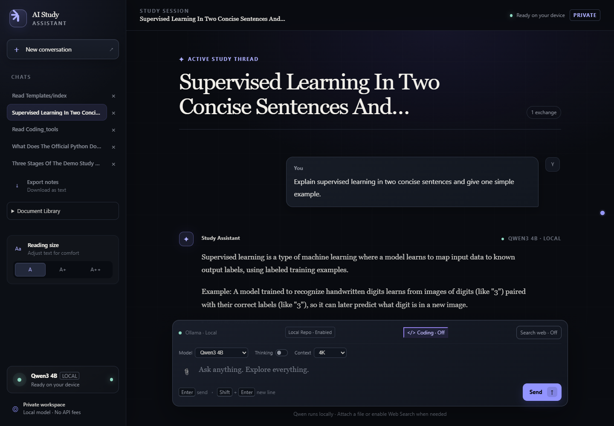
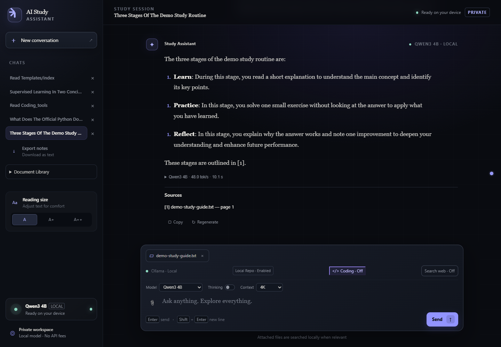
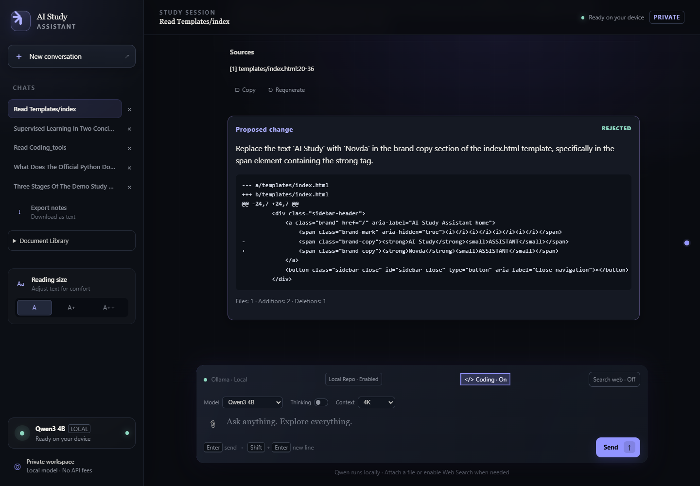
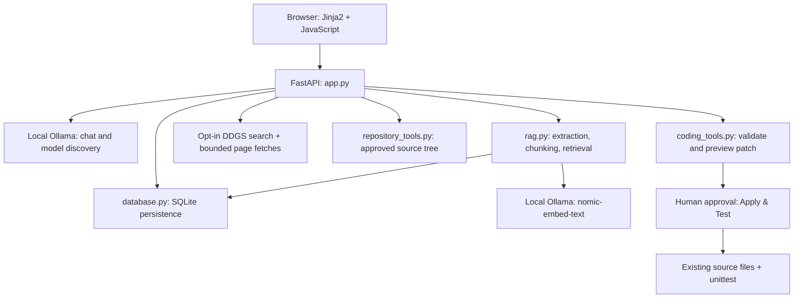

# Novda

**Local-First AI Assistant & Agent Platform**

## Overview

Novda is an experimental local-first AI system built around FastAPI, Ollama,
local embeddings, retrieval, web research, repository tools, and controlled
coding capabilities. A browser interface brings these workflows together while
keeping chat inference, document processing, and conversation storage on your
device by default. Web research is an explicit online workflow.

This project explores how a local assistant can work with evidence and bounded
tools. Coding Mode proposes edits for human review; Novda is not a fully
autonomous coding agent. Some existing interface labels still say "AI Study
Assistant"; the project name is **Novda**.

## Screenshots

These are actual browser captures from an isolated store containing only synthetic
demo content. No personal conversations or documents were used.







See the [web search](docs/screenshots/web-search.png) and
[repository search](docs/screenshots/repository.png) captures, or the
[screenshot guide](docs/screenshots/README.md).

## Current features

- FastAPI backend with a Jinja2 browser UI and vanilla JavaScript.
- Streaming local chat, stop/retry, response regeneration, and text export.
- Ollama model discovery and switching, a thinking toggle, and 4K/8K/16K context
  settings saved per conversation. Thinking support depends on the model;
  separate model thinking output is not displayed.
- Persistent SQLite conversations, source snapshots, runtime metrics, and
  document selections.
- Local document RAG with `nomic-embed-text`, PDF/TXT/Markdown attachments,
  cosine-similarity retrieval, and document/page citations.
- Opt-in web search with ranked evidence, numbered citations, and source links.
- Bounded repository directory listing, file search, text search, and numbered
  reads, with backend-owned `file:line` references.
- Experimental Coding Mode: approval-gated patches, an authoritative diff
  preview, stale-source checks, and **Apply & Test** with a fixed unittest runner.

## Architecture



| Location | Responsibility |
| --- | --- |
| `app.py` | Routes, chat streaming, model settings, evidence orchestration, patch approval |
| `database.py` | SQLite schema, additive migrations, conversations, documents, patch records |
| `rag.py` | Text extraction, overlapping chunks, local embeddings, evidence selection |
| `repository_tools.py` | Approved-root access, bounded reads/searches, source references |
| `coding_tools.py` | Structured proposal validation, generated diffs, writes, fixed test command |
| `templates/`, `static/` | Browser layout, styles, interactions, streaming response rendering |
| `test_*.py` | Unittest regression and safety checks |
| `docs/` | Public-release checklist and screenshot guidance |
| `data/` | Private runtime state, created automatically and excluded from Git |

## Technology stack

Python, FastAPI, Uvicorn, Jinja2, HTTPX, SQLite, Ollama, DDGS, pypdf, HTML/CSS,
and vanilla JavaScript. SQLite and unittest are part of Python. There is no
frontend build step, hosted vector database, or required paid API.

The release-preparation checks ran on Python 3.12 with FastAPI 0.141.1,
Uvicorn 0.52.0, Jinja2 3.1.6, python-multipart 0.0.32, HTTPX 0.28.1,
DDGS 9.16.0, and pypdf 6.18.1. `requirements.txt` retains bounded version ranges;
it is not a lockfile or a claim that every version combination has been tested.
The same suite also passed after a clean install resolved FastAPI 0.143.0,
Uvicorn 0.54.0, and pypdf 6.20.0, with the other direct dependency versions unchanged.

## Installation

Install Python 3.12, Git, and [Ollama](https://ollama.com/download).
Clone your copy of this repository, open a terminal in its root, then run:

```powershell
python -m venv .venv
.\.venv\Scripts\Activate.ps1
python -m pip install -r requirements.txt
```

On macOS/Linux, activate with `source .venv/bin/activate` instead. If PowerShell
blocks activation, use `.\.venv\Scripts\python.exe` directly for the Python
commands. Installation and model downloads require network access.

### Optional configuration

Defaults preserve the existing setup: Ollama at `http://localhost:11434` and
the database at `data/study_assistant.db`, relative to the source directory.
There are no machine-specific absolute paths in the application.

[`.env.example`](.env.example) lists the optional process environment settings.
It is a reference template; Novda does **not** automatically load `.env` files.
Set overrides in the same terminal before starting the server:

```powershell
$env:OLLAMA_BASE_URL = "http://localhost:11434"
$env:NOVDA_DATA_DIR = "data"
```

On macOS/Linux, use `export OLLAMA_BASE_URL=http://localhost:11434` and
`export NOVDA_DATA_DIR=data`. Chat and embeddings share the Ollama endpoint.
`NOVDA_DATA_DIR` can be absolute or relative to the project; it contains the
database and `documents/` uploads. Use a directory dedicated to runtime data.
Changing this setting selects a different store; it does not migrate existing
data. If using a custom directory inside the repository, add it to `.gitignore`
before staging files. A remote Ollama endpoint sends prompts and document text
to that endpoint; local-first operation requires a local endpoint and local models.

## Running Ollama

Start the Ollama application or, if no server is already running:

```text
ollama serve
```

The default API endpoint is `http://localhost:11434`. Keep Ollama running while
using Novda. See the [Ollama CLI reference](https://docs.ollama.com/cli).

## Installing required models

Install at least one local chat model that fits your hardware. For example:

```text
ollama pull qwen3:4b
ollama pull nomic-embed-text
ollama list
```

[`qwen3:4b`](https://ollama.com/library/qwen3:4b) is an example, not a fixed
requirement. [`nomic-embed-text`](https://ollama.com/library/nomic-embed-text)
is required for document indexing and retrieval; plain chat does not require it.
Novda currently prefers `ornith-1.5:9b` when installed, preserving the existing
local setup. Otherwise it selects an available chat model. No custom model
weights or instructions for obtaining that preferred model are bundled.
Embedding models are filtered out of the chat selector.

### Verified model settings and memory troubleshooting

The release smoke test successfully streamed through Novda using the installed
`qwen3:4b-instruct-2507-q4_K_M` model with thinking off at both 4K and 8K context.
On the tested 16 GB RAM / 6 GB VRAM machine, start with that model at **4K**;
context and model size affect memory demand. The 16K option remains available
but was not live-tested.

The installed `ornith-1.5:9b` failed even on a direct Ollama `/api/chat` request
with `num_ctx: 4096`, `num_predict: 16`, and `think: false`. Ollama reported an
inability to allocate a **2,923,940,352-byte CUDA_Host buffer**, after a projector
CPU offload retry. This is an Ollama model-loading allocation failure reproduced
outside Novda. The 9B model's roughly 6.1 GiB weights plus runtime overhead put
pressure on this hardware; the exact driver/allocator cause was not established.
Use the verified smaller model, release competing memory, or use hardware with
more capacity before retrying the larger model. No functionality or context
options were removed. See the [Ollama memory/context guidance](https://docs.ollama.com/faq)
and [release verification report](docs/RELEASE_VERIFICATION.md).

## Starting Novda

From the project root, with your Python environment active:

```text
python -m uvicorn app:app --host 127.0.0.1 --port 8000
```

Open [http://127.0.0.1:8000](http://127.0.0.1:8000). Startup creates the runtime
directories and initializes or additively migrates the SQLite database. Bind to
loopback: the application is intended for a trusted, single-user local workspace.

## Usage

Create a conversation, choose an installed model, set thinking/context options,
and send a question. Responses stream into the browser. You can stop generation,
retry an unanswered question, regenerate an answer, copy text/code, export a
conversation, or return to a saved chat. Reading-size preferences stay in browser
local storage. Conversations and source snapshots stay in SQLite.

## RAG/document workflow

1. Use the attachment button to upload a PDF, UTF-8 TXT, or Markdown file.
2. Novda extracts text, splits overlapping chunks, and embeds them locally using
   `nomic-embed-text:latest`. Wait until the document is ready.
3. Select documents in the Document Library or keep the uploaded attachment
   selected for the current chat, then ask a specific question.
4. Retrieval supplies up to four relevant passages with numbered document/page
   sources. When no passages pass the similarity threshold, Novda reports
   insufficient evidence instead of generating an unsupported document answer.

Uploads are limited to 20 MB, PDFs to 300 pages, extracted text to one million
characters, indexing to 1,500 chunks, and selection to 20 ready documents.
Scanned PDFs need external OCR; encrypted PDFs are unsupported. Detaching a
document removes it from that chat's selection; deleting it removes the library
copy and chunks. Previously saved answers retain their cited excerpts, so deleting
a document does not erase its text from conversation history.

Attached files are used automatically for ordinary questions. Repository-like
questions route to source tools; explicit web search takes priority over normal
attachment retrieval. For Coding Mode, turn web search off to obtain repository
evidence reliably.

## Web search

Enable **Search web** for online research. DDGS queries DuckDuckGo, then the backend
ranks candidates and retains up to five relevant sources. It attempts bounded
page fetches, with search snippets as fallback, and supplies numbered evidence
to the model. The backend removes citation numbers that are outside the supplied
source set before saving the completed answer.

Search queries can include recent user topic context and leave your device.
The backend validates public HTTP(S) destinations and redirects, pins fetched
connections to a validated IP, and limits fetch size/time. Search quality and
availability depend on external services. A valid citation number is not proof
that a generated claim accurately reflects its source.

## Repository access

The approved root is the Novda source directory, derived from `__file__`; there
is no browser control for granting access to arbitrary repositories. Ask, for
example, "Read app.py lines 437 to 468" or "Where is conversation persistence
implemented?" The backend supplies exact relative paths and line ranges.

Tools reject absolute paths, parent traversal, resolved paths outside the root,
private runtime directories, common credential filenames, and unsupported
binary files. Reads/searches have byte, line, result, and per-turn call limits.
The public `.env.example` remains readable. Source exclusions are a bounded
policy, not a general secret detector; keep sensitive material outside source
directories. Git exclusions and repository-tool exclusions serve different purposes.

## Coding Mode

Enable **Coding**, leave **Search web** off, and request a small edit to an existing
source file. The model returns a structured proposal; the backend validates it
and generates the authoritative unified diff. Review that diff, then choose
**Reject** or **Apply & Test**.

Proposal generation is model-dependent. In the live release review, one proposal
passed validation and was reviewed and rejected; three others were safely refused
for empty changes or expected text that did not match the source. Provide a precise
file, line range, and exact existing text, and review any retry. No patch was applied
during the browser smoke test.

A proposal can change at most three existing supported text files, with one
unique expected-text replacement per file. There are no model-provided shell
commands, new-file operations, or file deletions. Applying verifies that each
file still matches its preview, writes the approved text, and runs the fixed
`python -m unittest discover` command with a 120-second timeout and bounded output.

**Approval writes source code, and tests execute Python code with your user's
permissions.** This is not an execution sandbox. A failing test does not roll back
the applied edit; multi-file writes are not transactional. Keep a backup or a
clean Git commit before applying changes. Concurrent proposals and applications
have not been verified as a safe multi-user workflow.

## Security model

- Local inference and document embeddings by default; online web research is opt-in.
- SQLite state and document uploads are private runtime files excluded from Git.
  Storage is not encrypted by the application.
- Retrieved text is presented as untrusted evidence, with prompts instructing
  the model to ignore embedded instructions. Prompting is not a security boundary.
- Repository access is bounded to approved paths; patch writes require an
  explicit Apply action and a matching preview.
- There is no application authentication, user isolation, or comprehensive CSRF
  protection. Do not expose this server publicly or treat it as a hardened service.
- Diagnostic logs can contain search/repository questions and document filenames;
  conversation exports and screenshots can contain private evidence. Review them
  before sharing. `.gitignore` cannot remove files already committed to history.

See [`docs/RELEASE_CHECKLIST.md`](docs/RELEASE_CHECKLIST.md) before publishing.

## Tests

```text
python -m unittest discover
python -m compileall -q app.py database.py rag.py repository_tools.py coding_tools.py
node --check static/app.js
```

Node.js is only needed for the optional JavaScript syntax check. The Python suite
uses temporary databases and mocked model/search calls; it checks persistence,
model payloads, RAG, evidence/citation handling, repository boundaries, patch
previews, stale writes, and configuration portability. It does not certify live
model quality, internet search availability, browser rendering, or hostile code
execution safety. Perform a live local smoke test before a release.

The [2026-10-10 release verification](docs/RELEASE_VERIFICATION.md) also exercised
real local streaming, saved conversations, model/context settings, document RAG,
unpaid web search, repository tools, and proposal review in an isolated Edge browser.
It recorded zero JavaScript console or page errors after repairing a missing
footer helper that had prevented message submission.

The GitHub Actions workflow runs the regression, dependency, and syntax checks
on Python 3.12 for Windows and Ubuntu after pushing or opening a pull request.
It uses mocked model/search calls and does not require Ollama, API keys, or user data.

## Current limitations

- Experimental single-user application; no autonomous planning/verification loop.
- Model output, evidence relevance, and proposed edits still need human review.
- Text-only chat and extraction; no built-in OCR, image input, or voice interaction.
- Small, bounded document retrieval using SQLite-stored vectors and Python scoring;
  indexing and long histories can become slow or exceed practical context budgets.
- Model compatibility and speed depend on local hardware, installed models, and
  Ollama support for context/thinking controls.
- Repository access is limited to this source tree; coding handles small existing-file
  edits and offers no rollback, transaction, or execution isolation.
- Dependency ranges are not reproducibly locked; broader platform/version coverage
  and model-quality validation remain work in progress.

## Roadmap

- Stronger agent verification and safer edit validation.
- Richer tool/function calling.
- Multimodal input and voice interaction.
- Expanded integrations.
- A remote interface with appropriate authentication and isolation.

These are exploratory directions, not release commitments.

## License

Novda is intentionally unlicensed for now. No `LICENSE` file is included.
